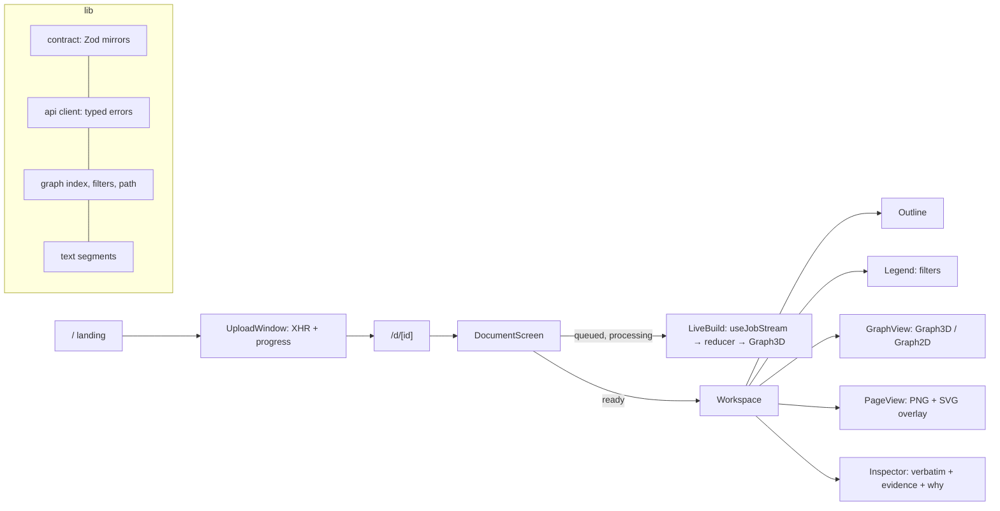

# Architecture

- Every server payload is parsed with Zod at the boundary (`src/lib/contract`).
- Every browser read goes through `/api/backend/[...path]`, a same-origin proxy that mints a
  60-second Ed25519 platform token (contract v2, `aud: "inkthread"`) per call and streams the answer
  back, the job's event stream included. Uploads take a one-minute token from `/api/upload-token`
  and go straight to the backend, past Vercel's 4.5 MB body limit ([spec 02](specs/02-backend-proxy.md)).
- The graph is indexed once into adjacency maps; filters, neighbours and the shortest typed path read
  from it.
- WebGL and canvas views load only on the client (`next/dynamic`, `ssr: false`, inside a client wrapper).
- The live build folds named SSE events into state with a pure reducer; a terminal latch stops
  reconnects after `done` or `failed`, and `?after=` resumes a dropped stream.
