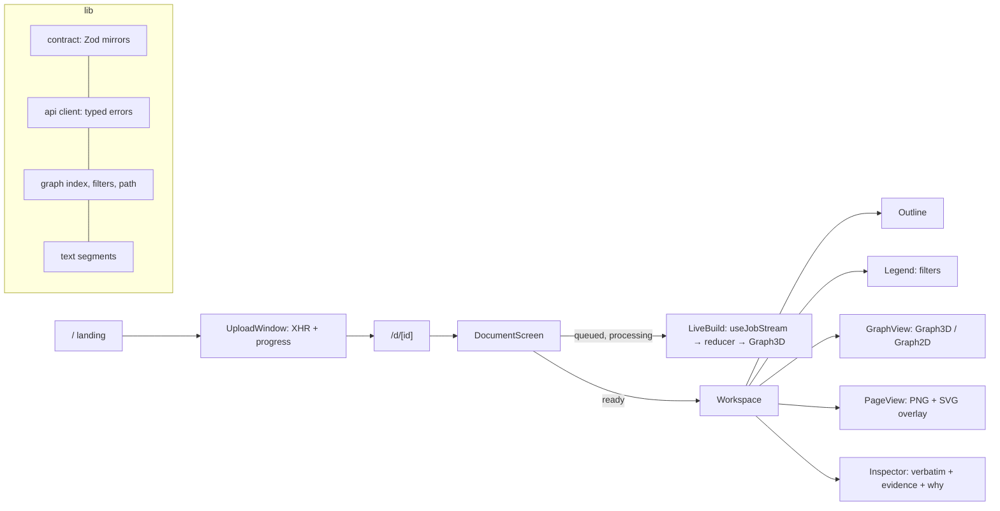

# Architecture

- Every server payload is parsed with Zod at the boundary (`src/lib/contract`).
- The graph is indexed once into adjacency maps; filters, neighbours and the shortest typed path read
  from it.
- WebGL and canvas views load only on the client (`next/dynamic`, `ssr: false`, inside a client wrapper).
- The live build folds named SSE events into state with a pure reducer; a terminal latch stops
  reconnects after `done` or `failed`, and `?after=` resumes a dropped stream.
